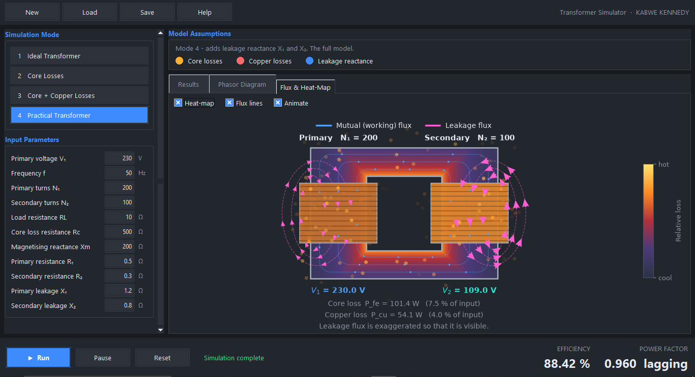
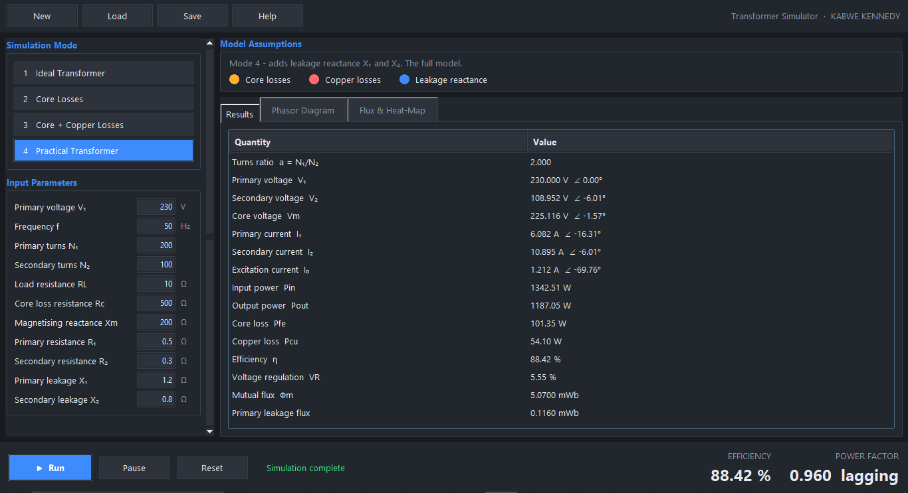
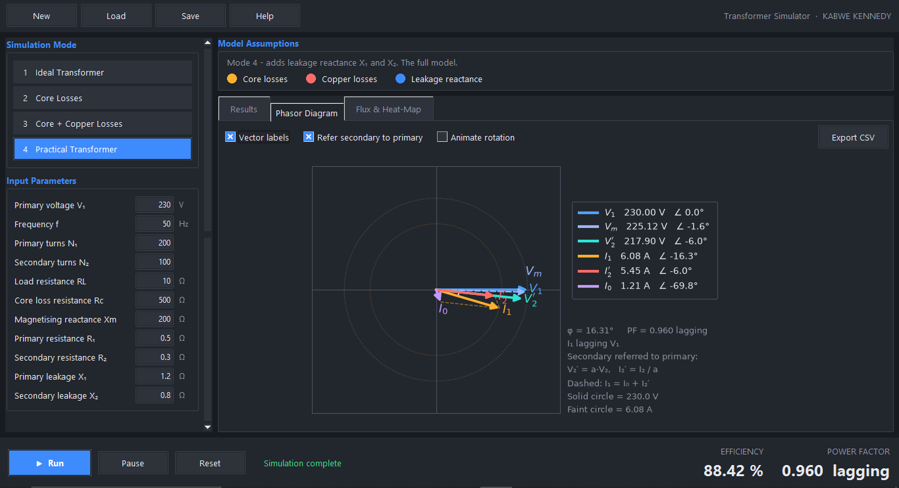
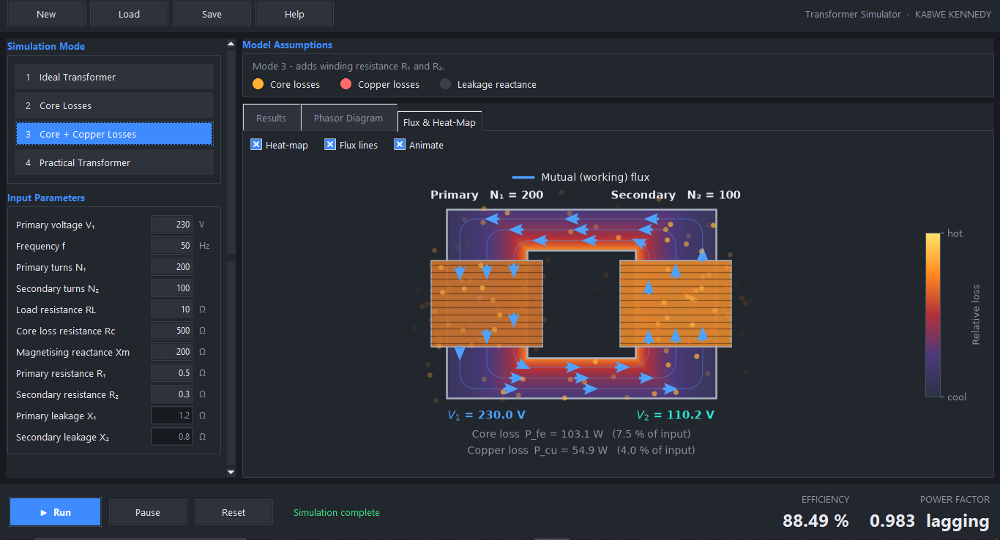
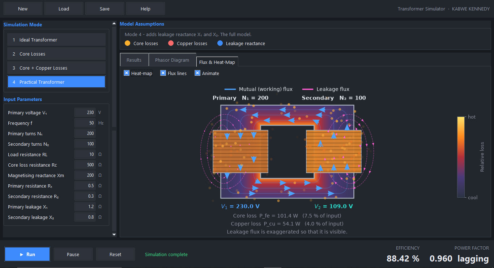
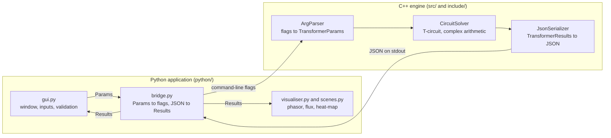
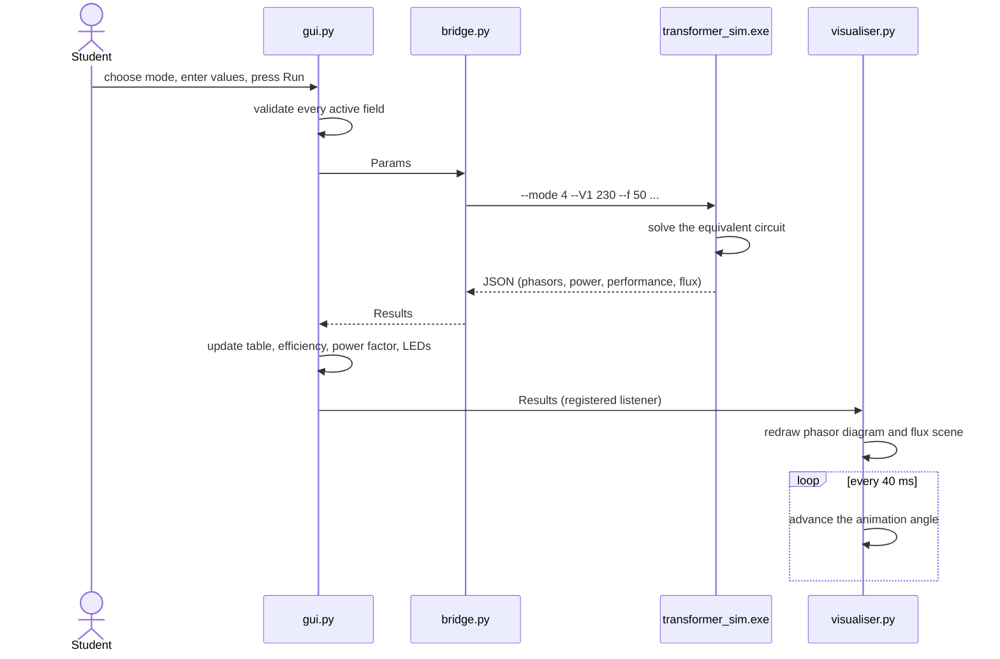

# Transformer Simulator

[](#roadmap)
[](#architecture)
[](#getting-started)
[](LICENSE.txt)

**An interactive single-phase transformer simulator for electrical machines students.**
A C++ engine solves the transformer equivalent circuit. A Python application turns the
numbers into phasor diagrams, magnetic flux animations and a live loss heat-map.

**Author: KABWE KENNEDY**

<!-- HERO IMAGE: full application window, Mode 4, Flux & Heat-Map tab, default inputs.
     Save as docs/screenshots/main-window.png -->
<p align="center">
  
</p>

---

## Contents

1. [The problem](#the-problem)
2. [What the software does](#what-the-software-does)
3. [Screenshots](#screenshots)
4. [The four models](#the-four-models)
5. [Inputs and outputs](#inputs-and-outputs)
6. [Architecture](#architecture)
7. [Getting started](#getting-started)
8. [Reference results and validation](#reference-results-and-validation)
9. [Reading the visualisations](#reading-the-visualisations)
10. [Project structure](#project-structure)
11. [Known limitations](#known-limitations)
12. [Roadmap](#roadmap)
13. [Development workflow](#development-workflow)
14. [License](#license)

---

## The problem

Transformers are one of the first topics in electrical machines, and one of the
hardest to *see*. Textbooks present the equivalent circuit as a static drawing, add
one loss mechanism after another in separate chapters, and ask students to picture
phasors and magnetic flux that cannot be observed directly. A student can follow each
equation yet still not understand:

- what each loss mechanism physically does to the voltages, currents and efficiency
- why the primary current lags the voltage, and by how much
- the difference between the working (mutual) flux and the leakage flux
- where the lost energy actually goes

## What the software does

Transformer Simulator lets a student **switch the physics on one layer at a time** and
watch the consequences immediately. Start from an ideal transformer, add core losses,
then copper losses, then leakage reactance, and see every change in the numbers, the
phasor diagram and the flux and heat picture.

| Area | What you get |
|------|--------------|
| Models | Four progressive models: ideal, core losses, core + copper losses, practical |
| Inputs | Voltage, frequency, turns, load and all equivalent-circuit parameters, with tooltips and validation |
| Results | Phasors (magnitude and angle), powers, losses, efficiency, power factor (leading or lagging), voltage regulation, flux |
| Phasor diagram | V1, V2, I1, I2 with Vm and I0, secondary referred to primary, animated rotation, CSV export |
| Flux view | Working flux through the core and leakage flux around each winding, reversing every half cycle |
| Loss heat-map | Core and windings coloured by how much energy they lose, with heat leaving the hot parts |
| Status LEDs | Show at a glance which physical effects the selected model includes |
| Files | Save and load simulation set-ups |

## Screenshots

<!-- Add 4 images to docs/screenshots/ using exactly these names.
     Use the default inputs (press Reset) and 50 Hz so readers can reproduce them. -->

| Results table | Phasor diagram |
|:---:|:---:|
|  |  |
| Every phasor, power, loss and flux value | I1 = I0 + I2' shown as a vector sum; power-factor angle marked |

| Core and copper loss heat-map (Mode 3) | Leakage flux (Mode 4) |
|:---:|:---:|
|  |  |
| Inner core edge runs hottest; windings heat with I squared R | Mutual flux links both coils, leakage flux links only one |

## The four models

Each mode includes everything in the modes before it.

| Mode | Model | Physical effect added | What the student sees |
|:---:|-------|-----------------------|-----------------------|
| 1 | Ideal transformer | Turns ratio only | Voltage and current scaled by the turns ratio, 100 % efficiency, all phasors in phase |
| 2 | Core losses | Rc (hysteresis and eddy currents), Xm (magnetising current) | Excitation current I0, a lagging power factor, core loss, core heat-map |
| 3 | Core + copper losses | R1, R2 (winding resistance) | Voltage drop, voltage regulation, I squared R loss, windings heat up |
| 4 | Practical transformer | X1, X2 (leakage reactance) | Larger phase shift and voltage drop, leakage flux drawn around each coil |

## Inputs and outputs

**Inputs.** Fields that do not belong to the selected mode are greyed out and are not
sent to the engine.

| Parameter | Symbol | Unit | Active from |
|-----------|:------:|:----:|:-----------:|
| Primary voltage (RMS) | V1 | V | Mode 1 |
| Frequency | f | Hz | Mode 1 |
| Primary turns | N1 | | Mode 1 |
| Secondary turns | N2 | | Mode 1 |
| Load resistance | RL | ohm | Mode 1 |
| Core loss resistance | Rc | ohm | Mode 2 |
| Magnetising reactance | Xm | ohm | Mode 2 |
| Primary winding resistance | R1 | ohm | Mode 3 |
| Secondary winding resistance | R2 | ohm | Mode 3 |
| Primary leakage reactance | X1 | ohm | Mode 4 |
| Secondary leakage reactance | X2 | ohm | Mode 4 |

**Outputs.**

| Output | Symbol | Unit |
|--------|:------:|:----:|
| Secondary voltage | V2 | V, with phase angle |
| Primary, secondary and excitation currents | I1, I2, I0 | A, with phase angle |
| Voltage across the magnetising branch | Vm | V |
| Input and output power | Pin, Pout | W |
| Core loss and copper loss | Pfe, Pcu | W |
| Efficiency | eta | % |
| Power factor | cos phi | leading or lagging |
| Voltage regulation | VR | % |
| Mutual and leakage flux | Phi | Wb |

## Architecture

The program is deliberately split in two. **C++ does the engineering mathematics.**
**Python does the interface and drawing.** The two only ever communicate through
command-line flags going in and JSON coming out, so either side can be changed or
replaced without touching the other.

### System overview



### Data flow of one simulation

What happens when the student presses **Run**:



### The circuit that is solved

The standard T-equivalent circuit with all quantities referred to the primary side:

```
          Z1 = R1 + jX1                Z2' = a^2 (R2 + jX2)
   o------[ Z1 ]------+---------------[ Z2' ]------+
                      |                            |
   V1             [ Rc || jXm ]               [ RL' = a^2 RL ]
                      |                            |
   o------------------+----------------------------+

   a = N1 / N2        shunt branch = core model      Z1, Z2' = winding model
```

Writing Kirchhoff's current law at the middle node gives one equation that covers all
four modes:

```
Vm = V1 / ( 1 + Z1 * ( Y_shunt + Y_load' ) )
```

Parameters that belong to a later mode are simply zero, which removes their branch
from the circuit. Everything else follows from `Vm`:

```
I1 = (V1 - Vm) / Z1        I0 = Vm * Y_shunt        I2' = Vm * Y_load'
Pin = Re( V1 * conj(I1) )  Pfe = |Vm|^2 / Rc        Pcu = |I1|^2 R1 + |I2|^2 R2
eta = Pout / Pin * 100     Phi_peak = Vm / ( 4.44 f N1 )
```

### The data contract

The engine prints one JSON object. This is everything the Python side is allowed to
know about a simulation (shortened here):

```json
{
  "status": "ok",
  "mode": 4,
  "turns_ratio": 2.0,
  "phasors": { "V1": { "magnitude": 230.0, "angle_deg": 0.0 }, "V2": {}, "I1": {}, "I2": {}, "I0": {}, "Vm": {} },
  "power": { "P_in_W": 1342.5, "P_out_W": 1187.0, "P_fe_W": 101.4, "P_cu_W": 54.1 },
  "performance": { "efficiency_pct": 88.42, "power_factor": 0.960, "voltage_reg_pct": 5.55 },
  "flux": { "mutual_Wb": 0.00507, "leakage1_Wb": 0.000116, "leakage2_Wb": 0.000277 }
}
```

Errors go to a different channel (a JSON `"status": "error"` message for rejected
inputs, or standard error for a bad command line), so a failure can never be
mistaken for a result.

### Design decisions

- **Two languages, one boundary.** The calculation code can be tested from a terminal
  without any GUI, and the interface can change without risking the maths.
- **Drawing is separate from the window.** `scenes.py` only uses matplotlib, so every
  figure can be rendered to an image and tested without opening a window.
- **One table describes every input field.** Adding an input later means adding one
  row, and the field, tooltip, validation and mode switching follow.
- **The GUI never talks to the visualiser directly.** The visualiser registers
  itself as a listener, so the two stay independent.

## Getting started

### Requirements

| Tool | Version |
|------|---------|
| CMake | 3.20 or newer |
| g++ (MSYS2 MinGW-w64) | C++17 support |
| Python | 3.10 or newer, with Tkinter |
| Git | any |

Developed and tested on Windows 10 with MSYS2 g++.

### 1. Get the code

```bash
git clone https://github.com/<your-username>/<repository-name>.git
cd <repository-name>
```

### 2. Build the C++ engine (MSYS2 MINGW64 terminal)

```bash
cmake -S . -B build -G "MinGW Makefiles" -DCMAKE_BUILD_TYPE=Release
cmake --build build --parallel
```

The engine is created at `build/bin/transformer_sim.exe`.

### 3. Set up Python (PowerShell, from the project root)

```powershell
python -m venv .venv
.venv\Scripts\Activate.ps1
pip install -r requirements.txt
```

### 4. Run

```powershell
python python/main.py
```

### Using the engine without the GUI

```bash
./build/bin/transformer_sim.exe --mode 4 --V1 230 --f 50 --N1 200 --N2 100 --RL 10 \
    --Rc 500 --Xm 200 --R1 0.5 --R2 0.3 --X1 1.2 --X2 0.8
```

Run it with `--help` for every flag.

### A suggested first session

1. Press **Reset**, choose **Mode 1** and note V2, I1 and the 100 % efficiency.
2. Switch to **Mode 2**. Watch efficiency drop and a lagging power factor appear.
   Open the **Phasor Diagram** and find I0.
3. Lower **Rc** and press Run. More core loss, hotter core in the heat-map.
4. Switch to **Mode 3**. V2 falls and voltage regulation becomes non-zero.
5. Switch to **Mode 4** and open **Flux & Heat-Map**. Compare the working flux
   with the leakage flux.
6. Lower **RL** so the transformer is loaded harder and compare every number.

## Reference results and validation

The engine was checked against hand calculation. With the default inputs
(V1 = 230 V, f = 50 Hz, N1 = 200, N2 = 100, RL = 10 ohm, Rc = 500 ohm, Xm = 200 ohm,
R1 = 0.5 ohm, R2 = 0.3 ohm, X1 = 1.2 ohm, X2 = 0.8 ohm):

| Mode | V2 (V) | I1 (A) | Pfe (W) | Pcu (W) | Efficiency (%) | Power factor | VR (%) |
|:----:|:------:|:------:|:-------:|:-------:|:--------------:|:------------:|:------:|
| 1 | 115.00 | 5.750 | 0.00 | 0.00 | 100.00 | 1.000 | 0.00 |
| 2 | 115.00 | 6.316 | 105.80 | 0.00 | 92.59 | 0.983 | 0.00 |
| 3 | 110.20 | 6.071 | 103.07 | 54.86 | 88.49 | 0.983 | 4.35 |
| 4 | 108.95 | 6.082 | 101.35 | 54.10 | 88.42 | 0.960 | 5.55 |

Hand checks:

- **Mode 1.** a = 200 / 100 = 2, so V2 = 230 / 2 = 115 V, I2 = 115 / 10 = 11.5 A,
  I1 = 11.5 / 2 = 5.75 A, and P = 11.5 squared x 10 = 1322.5 W.
- **Mode 2.** With no series impedance Vm = V1, so Pfe = 230 squared / 500 = 105.8 W.
- **Energy balance, every mode.** Pin = Pout + Pfe + Pcu.

## Reading the visualisations

- **Phasor diagram.** Voltages share one length scale and currents share another, so
  angles are accurate. With *Refer secondary to primary* on, V2' = a V2 and
  I2' = I2 / a, which makes I1 = I0 + I2' a true vector sum (dashed lines).
  In Mode 1, V1 and V2' are the same arrow, which is correct for an ideal transformer.
- **Flux arrows.** Their direction reverses every half cycle. Mutual flux follows the
  core voltage by 90 degrees, and leakage flux follows its own winding current.
  The animation runs in slow motion (one electrical cycle every five seconds).
- **Heat-map.** Colour is relative to input power: a core losing 10 % of Pin is shown
  fully hot, a winding losing 5 % is shown fully hot. Inside the core the loss density
  follows flux density squared, which is highest along the shorter inner path.
  It is a teaching picture, not a thermal simulation.
- **Leakage flux.** Real leakage flux is only a small fraction of the mutual flux, so
  its arrows are drawn larger than true scale so that they can be seen.

## Project structure

```
.
├── CMakeLists.txt
├── requirements.txt
├── LICENSE.txt
├── include/
│   ├── transformer/        TransformerParams.h, TransformerResults.h, CircuitSolver.h
│   └── utils/              ArgParser.h, JsonSerializer.h
├── src/
│   ├── main.cpp            engine entry point
│   ├── transformer/        CircuitSolver.cpp   (the physics)
│   └── utils/              ArgParser.cpp, JsonSerializer.cpp
├── python/
│   ├── main.py             application entry point
│   ├── gui.py              window, inputs, validation, results table
│   ├── bridge.py           runs the C++ engine, parses its JSON
│   ├── scenes.py           phasor and transformer drawings (matplotlib)
│   ├── visualiser.py       embeds the drawings, runs the animation clock
│   └── theme.py            colours and fonts
├── docs/
│   └── screenshots/        images used in this README
└── .vscode/                build and debug configuration
```

## Known limitations

Version 1.0.0 is a working first release. These are known and planned:

- Reactances Xm, X1 and X2 are fixed ohm values. They do **not** scale with
  frequency, so changing f currently changes only the flux.
- The load is purely resistive, so the power factor can be lagging or unity but
  never leading.
- Magnetic saturation and core non-linearity are not modelled.
- The Settings dialog from the original design specification is not built yet.
- Tested on Windows only.
- This is a teaching tool. It is not intended for transformer design or safety work.

## Roadmap

### Version 1.1 - physics accuracy

- [ ] Frequency-dependent reactances (X scales with f from a rated frequency)
- [ ] Load types: resistive, inductive (RL) and capacitive (RC), so leading power factor can be shown
- [ ] Automated C++ unit tests checked against hand-calculated values
- [ ] Continuous integration on every push (GitHub Actions)

### Version 1.2 - ready for the classroom

- [ ] Standalone Windows release: statically linked engine and a packaged application, no installation needed
- [ ] Settings dialog (theme, animation speed, units)
- [ ] Export of a full results report

### Version 2.0 - more transformer learning tools

- [ ] Open-circuit and short-circuit tests for determining equivalent-circuit parameters
- [ ] Efficiency and voltage regulation against load curves, and the maximum-efficiency point
- [ ] Per-unit system
- [ ] Autotransformer and three-phase transformer models

### Version 3.0 - more electrical machines

- [ ] DC machines
- [ ] Induction motor with torque-speed characteristic
- [ ] Synchronous machines
- [ ] Motor drives

## Development workflow

| Branch | Purpose |
|--------|---------|
| `main` | Stable, tagged releases only |
| `dev` | Integration of finished features |
| `feature/*` | One branch per feature, merged into `dev` |

Commit messages follow the convention `feat:`, `fix:`, `docs:`, `chore:`, `test:`.

## License

Released under the MIT License. See [LICENSE.txt](LICENSE.txt).

---

**Transformer Simulator** v1.0.0 - developed by **KABWE KENNEDY**